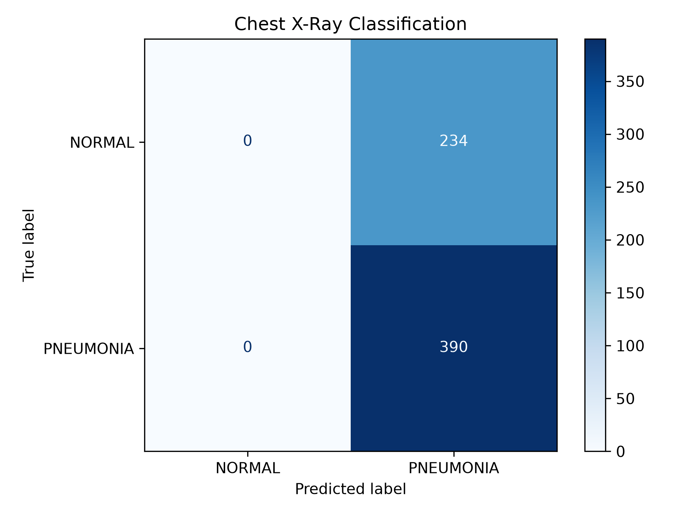
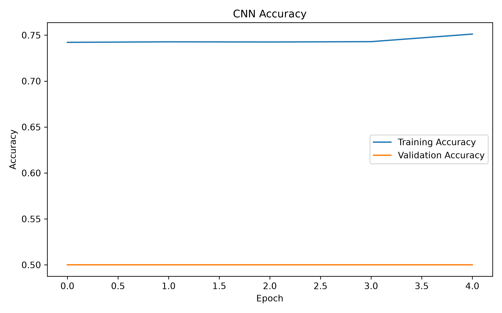
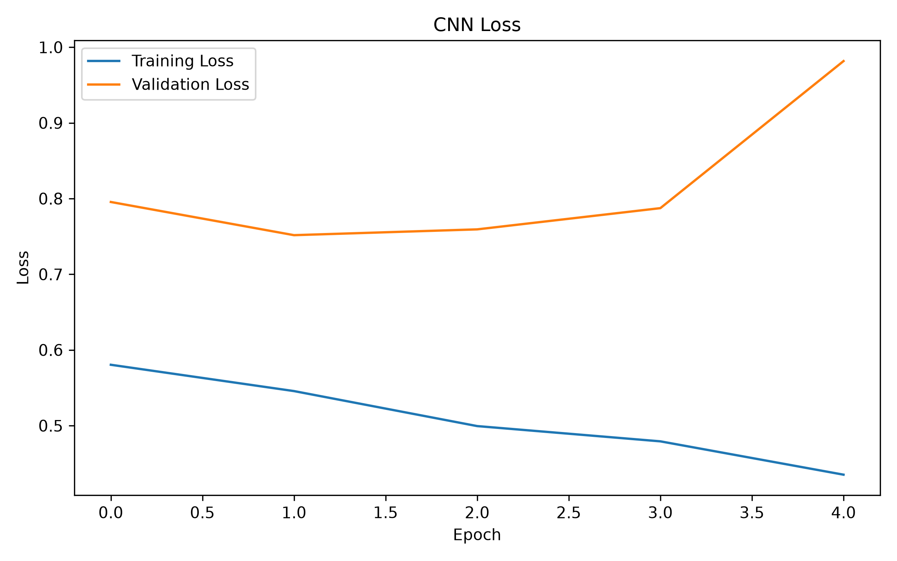

# AI-Powered Medical Image Analysis System

## Overview
An educational AI-based medical image classification project that uses a Convolutional Neural Network (CNN) to classify chest X-ray images into NORMAL and PNEUMONIA categories.

## Features
- Chest X-ray image classification
- CNN-based deep learning model
- Image preprocessing using OpenCV
- Model evaluation and accuracy graphs
- Confusion matrix and classification report
- Flask web application for image uploads
- Prediction score display

## Technologies Used
- Python
- TensorFlow and Keras
- OpenCV
- NumPy
- Matplotlib
- Scikit-learn
- Flask

## Project Structure
- `data/` – Dataset
- `src/` – Prediction script
- `models/` – Trained CNN model
- `outputs/` – Evaluation graphs
- `images/` – Project images
- `app.py` – Flask web application
- `main.py` – Model training and evaluation

## How to Run
1. Install the required packages using `pip install -r requirements.txt`.
2. Activate the virtual environment.
3. Run `python app.py`.
4. Open `http://127.0.0.1:5000` in your browser.
5. Upload a chest X-ray image and click Analyze Image.

## Disclaimer
This project is an educational prototype and is not clinically validated. It must not be used for medical diagnosis or healthcare decisions.
## Model Performance

### Confusion Matrix

### Accuracy Graph

### Loss Graph

## Disclaimer
This project is an educational prototype and is not intended for medical diagnosis.